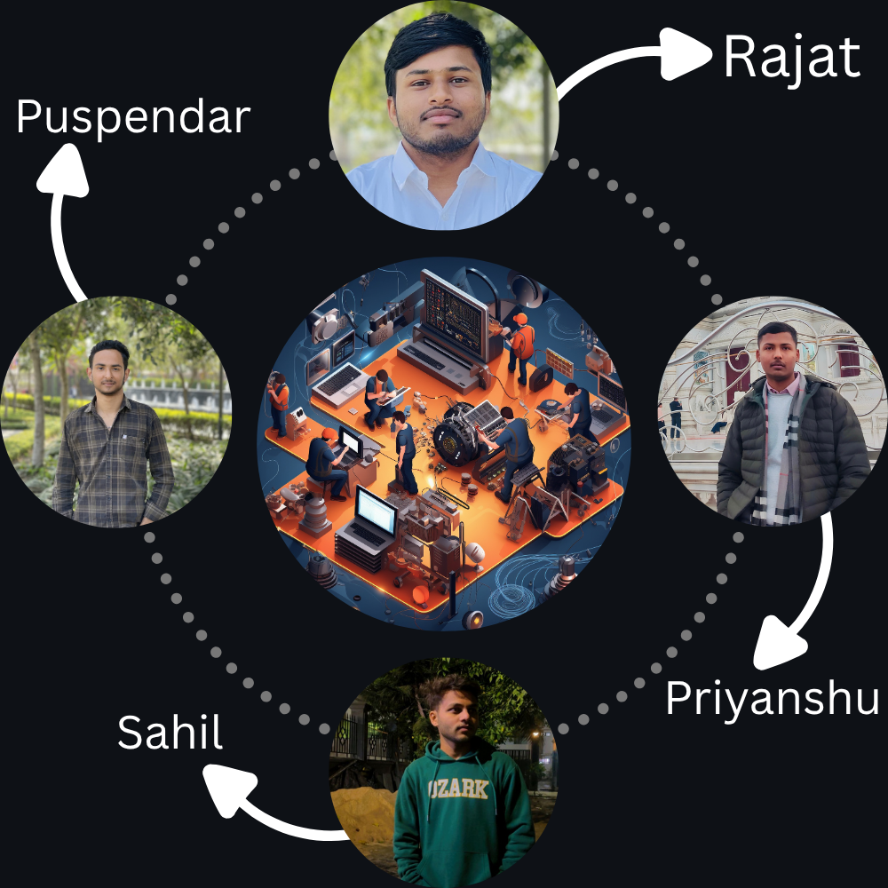

<div align="center">


<p align="center">
HookFlow is a webhook delivery engine designed for high-throughput, <b>zero-loss webhook ingestion</b>, <b>Redis-backed duplicate interception</b>, <b>secret key authentication</b>, and <b>automated background dispatching with retry handling</b>.
</p>


</div>

<!-- 2. Team Details Card -->
<div align="center" style="padding: 24px 24px; border-radius: 16px; border: 1px solid #30363d; background: linear-gradient(180deg, rgba(22, 27, 34, 0.9) 0%, rgba(13, 17, 23, 0.95) 100%); margin-bottom: 24px;">

  <table align="center" width="100%" style="max-width: 880px; margin: 0 auto; border-collapse: collapse; border: none;">
    <tr>
      <td width="54%" align="left" valign="middle" style="padding: 12px; border: none;">
        <h3 style="margin-top: 0; margin-bottom: 14px; font-size: 1.25em; letter-spacing: 0.2px;">Team Details</h3>
        <table width="100%" style="border-collapse: collapse; border-radius: 12px; overflow: hidden;">
          <thead>
            <tr style="background-color: rgba(110, 118, 129, 0.15);">
              <th align="left" style="padding: 10px 14px;">Role</th>
              <th align="left" style="padding: 10px 14px;">Name</th>
              <th align="left" style="padding: 10px 14px;">Roll Number</th>
            </tr>
          </thead>
          <tbody>
            <tr>
              <td align="left" valign="middle" style="padding: 10px 14px;"><strong>Team Leader</strong></td>
              <td align="left" valign="middle" style="padding: 10px 14px;">Rajat</td>
              <td align="left" valign="middle" style="padding: 10px 14px;"><code>2400290120197</code></td>
            </tr>
            <tr>
              <td align="left" valign="middle" style="padding: 10px 14px;"><strong>Contributor</strong></td>
              <td align="left" valign="middle" style="padding: 10px 14px;">Priyanshu Tewatiya</td>
              <td align="left" valign="middle" style="padding: 10px 14px;"><code>2400290120194</code></td>
            </tr>
            <tr>
              <td align="left" valign="middle" style="padding: 10px 14px;"><strong>Contributor</strong></td>
              <td align="left" valign="middle" style="padding: 10px 14px;">Puspendhar Chauhan</td>
              <td align="left" valign="middle" style="padding: 10px 14px;"><code>2400290120195</code></td>
            </tr>
            <tr>
              <td align="left" valign="middle" style="padding: 10px 14px;"><strong>Contributor</strong></td>
              <td align="left" valign="middle" style="padding: 10px 14px;">Sahil Kumar</td>
              <td align="left" valign="middle" style="padding: 10px 14px;"><code>2400290120215</code></td>
            </tr>
          </tbody>
        </table>
      </td>
      <td width="46%" align="center" valign="middle" style="padding: 12px; border: none;">
        
      </td>
    </tr>
  </table>

</div>

---

<h2 align="center">How It Works (Request Flow)</h2>

<table width="100%" style="border-collapse: collapse; margin: 16px 0;">
  <tr>
    <td style="padding: 16px; border-radius: 12px; border: 1px solid #30363d; background-color: rgba(22, 27, 34, 0.6);">

```text
[Client / Provider]
        │
        │  POST /api/events/ingest (secret-x-key, idempotency-key, payload)
        ▼
[Redis Idempotency Layer]
   ├── Duplicate request detected? ──> 409 Conflict (Discarded instantly, 0 DB load)
   └── First-time request?         ──> Set cache lock (TTL 300s) & Proceed
        ▼
[HookFlow Backend]
   ├── Validate organization secret-x-key
   └── Save event to MongoDB with status: "pending", attempts: 0
        │
        └── Return 202 Accepted { eventId, status: "pending" } (Instant response to client)
        │
[Background Dispatch Engine (Runs every 5s)]
   ├── Polls database for events where status == "pending" & nextRetryAt <= Now
   ├── Fetches destination webhook URL registered for that organization
   └── Forwards payload via HTTP POST to the destination server
        │
        ├── SUCCESS (2xx HTTP response)
        │     └── Updates event status to "completed"
        │
        └── FAILURE (Timeout / 4xx / 5xx)
              ├── Increments attempts count (+1)
              ├── If attempts < 3: Reschedules for next retry backoff
              └── If attempts >= 3: Marks status as "dead" (halting auto-retries for manual intervention)
```


  </tr>
</table>

---

<h2 align="center">Core Features &amp; Implementation</h2>

<table width="100%" style="border-collapse: separate; border-spacing: 12px; margin: 8px 0;">
  <tr>
    <td width="50%" valign="top" style="padding: 18px; border-radius: 12px; border: 1px solid #30363d; background-color: rgba(22, 27, 34, 0.5);">

### 1. Redis Idempotency Interception
- **Mechanism**: Uses `SET idemp:<secretKey>:<hash> processing EX 300 NX`.
- **Behavior**: If rapid repetitive requests or duplicate webhooks arrive within 5 minutes, Redis intercepts and returns `409 Conflict`, shielding your database and downstream destinations from duplicate event spikes.

    </td>
    <td width="50%" valign="top" style="padding: 18px; border-radius: 12px; border: 1px solid #30363d; background-color: rgba(22, 27, 34, 0.5);">

### 2. Organization Key Isolation
- **Mechanism**: Each organization generates an isolated secret key (`sec_<hex>`).
- **Behavior**: Ingestion endpoints verify the `secret-x-key` against the database before queuing payloads.

    </td>
  </tr>
  <tr>
    <td width="50%" valign="top" style="padding: 18px; border-radius: 12px; border: 1px solid #30363d; background-color: rgba(22, 27, 34, 0.5);">

### 3. Asynchronous Non-Blocking Ingestion
- **Mechanism**: Incoming requests return `202 Accepted` immediately upon ingestion.
- **Behavior**: The sender does not wait for downstream destination delivery. Processing happens decoupled in the background.

    </td>
    <td width="50%" valign="top" style="padding: 18px; border-radius: 12px; border: 1px solid #30363d; background-color: rgba(22, 27, 34, 0.5);">

### 4. Automated 5-Second Dispatcher & Circuit Breaker
- **Mechanism**: A recurring worker polls pending events every 5 seconds.
- **Retry & Dead-Letter Handling**: If destination endpoints fail, the engine attempts delivery up to 3 times (`MAX_ATTEMPTS = 3`). If all fail, the event is shifted to `dead` state, allowing manual inspection and retry from the dashboard.

    </td>
  </tr>
  <tr>
    <td colspan="2" valign="top" style="padding: 18px; border-radius: 12px; border: 1px solid #30363d; background-color: rgba(22, 27, 34, 0.5);">

### 5. MongoDB Atlas-Themed Operational Dashboard
- **Capabilities**: Live inspection of documents (`_id`, `user`, `secretKey`, `status`, `attempts`, `payload`), real-time status tracking, and 1-click retry dispatch for dead-letter events.

    </td>
  </tr>
</table>

---

<h2 align="center">API Quickstart</h2>

<table width="100%" style="border-collapse: collapse; margin: 16px 0;">
  <tr>
    <td style="padding: 18px; border-radius: 12px; border: 1px solid #30363d; background-color: rgba(22, 27, 34, 0.5);">

### Ingest Event
```http
POST http://localhost:2000/api/events/ingest
Content-Type: application/json
secret-x-key: sec_your_org_key
idempotency-key: unique-uuid-per-event

{
  "userId": "usr_6af0b7db7b540b7b50",
  "payload": {
    "orderId": "ORD-94821",
    "amount": 4900,
    "currency": "USD"
  }
}
```

    </td>
  </tr>
</table>

---

<h2 align="center">Running Locally</h2>

<table width="100%" style="border-collapse: separate; border-spacing: 12px; margin: 8px 0;">
  <tr>
    <td width="33.33%" valign="top" style="padding: 16px; border-radius: 12px; border: 1px solid #30363d; background-color: rgba(22, 27, 34, 0.5);">

1. **Start HookFlow Backend (Port 2000)**:
   ```bash
   cd Backend
   npm install
   npm run dev
   ```

    </td>
    <td width="33.33%" valign="top" style="padding: 16px; border-radius: 12px; border: 1px solid #30363d; background-color: rgba(22, 27, 34, 0.5);">

2. **Start HookFlow Frontend (Port 3000)**:
   ```bash
   cd frontend
   npm install
   npm run dev
   ```

    </td>
    <td width="33.33%" valign="top" style="padding: 16px; border-radius: 12px; border: 1px solid #30363d; background-color: rgba(22, 27, 34, 0.5);">

3. **Start Mock Event Sender / Receiver (Port 4000)**:
   ```bash
   cd backend2
   npm install
   npm run dev
   ```

    </td>
  </tr>
</table>
